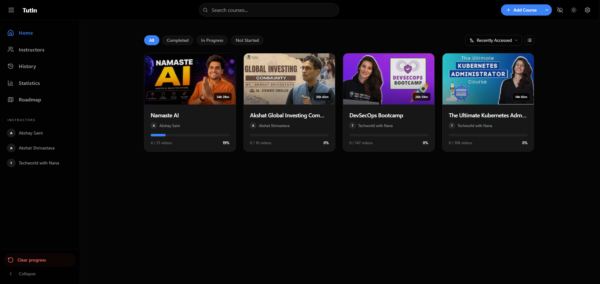
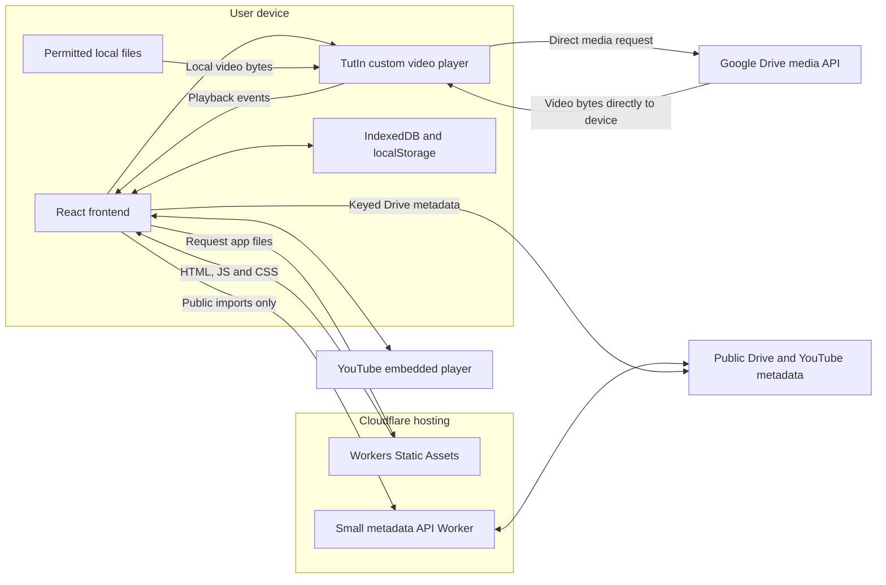
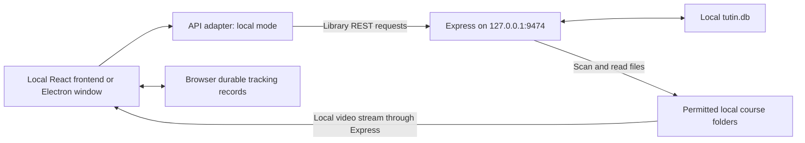
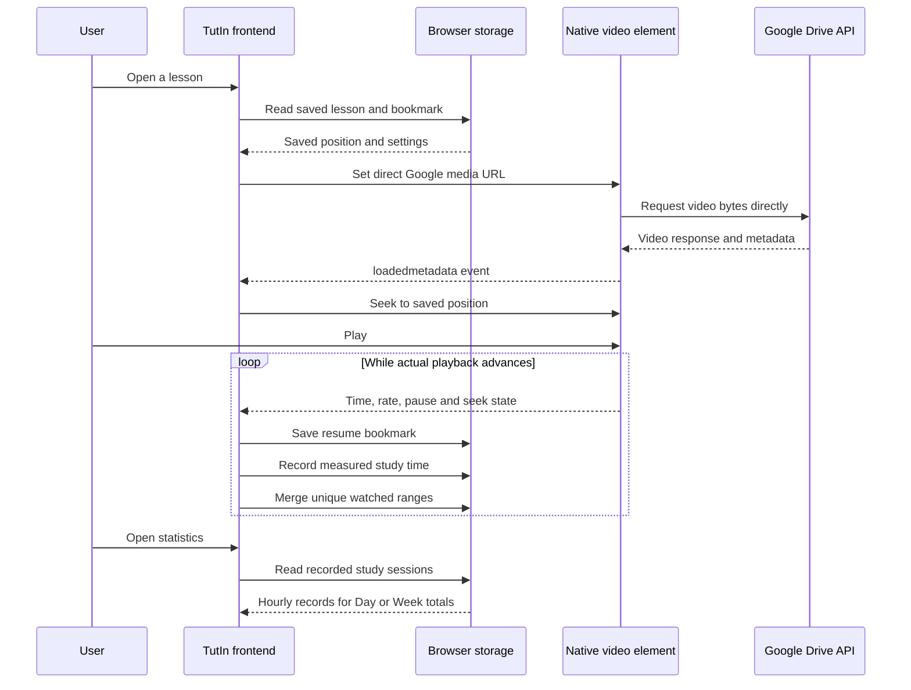
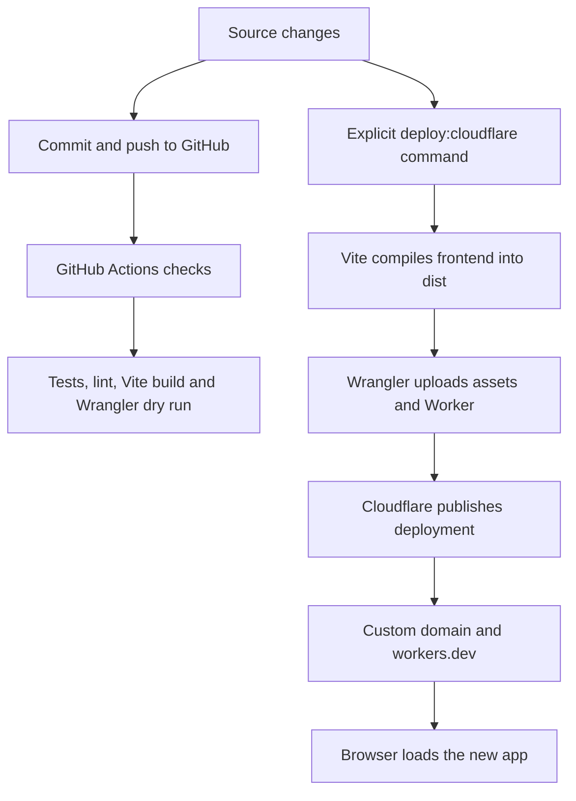

# TutIn — Video Course Learning Platform

[](package.json)
[](LICENSE)

TutIn organizes local video courses, Google Drive courses, and custom YouTube playlists. It combines a custom video player with resume positions, watched coverage, notes, subtitles, study statistics, and learning roadmaps.

**Live site:** [udemy.chaigallery.in](https://udemy.chaigallery.in/)
**Cloudflare fallback:** [tutin-learning.passishubham1.workers.dev](https://tutin-learning.passishubham1.workers.dev/)



## Contents

- [Architecture at a glance](#architecture-at-a-glance)
- [Frontend](#frontend)
- [Backend and operating modes](#backend-and-operating-modes)
- [Cloudflare responsibilities](#cloudflare-responsibilities)
- [How video playback and progress are linked](#how-video-playback-and-progress-are-linked)
- [Storage and backups](#storage-and-backups)
- [Google API configuration](#google-api-configuration)
- [AI transcription and summaries](#ai-transcription-and-summaries)
- [Local development](#local-development)
- [Cloudflare deployment](#cloudflare-deployment)
- [Validation and troubleshooting](#validation-and-troubleshooting)
- [Repository map](#repository-map)

## Architecture at a glance

TutIn has two operating modes. The production website runs as a browser application hosted on Cloudflare. The optional local/desktop mode connects the same frontend to an Express companion server on the user's computer.

For the hosted website, **video delivery and application hosting are separate**:

- Cloudflare delivers HTML, JavaScript, CSS, icons, and the offline shell.
- A small Cloudflare Worker handles public import metadata and a health endpoint.
- Google Drive sends video bytes directly to the browser's native video element.
- The frontend measures playback and saves progress in the browser.
- Express, SQLite, and Python services are not deployed to Cloudflare.



**There is no hosted video relay, playback redirect service, or Google Drive preview fallback.** The retired `/api/drive-video` endpoint returns HTTP `410 Gone` without fetching or redirecting video data.

Implementation: [frontend entry](src/main.jsx#L14), [mode selection](src/utils/api.js#L9), [Cloudflare Worker](cloudflare/worker.js#L7), [direct Drive sources](src/utils/directDrivePlayback.js#L3).

## Frontend

The frontend is a React 18 single-page application built with Vite 6, React Router 7, and Tailwind CSS. It executes on the user's device after Cloudflare serves the compiled files.

### Main responsibilities

| Component or layer | Responsibility | Implementation |
| --- | --- | --- |
| Startup | Hydrate durable progress, initialize providers, register the offline shell, and mount React | [main.jsx](src/main.jsx) |
| Routing and layout | Load pages on demand; provide navigation, search, imports, and error boundaries | [App.jsx](src/App.jsx), [layout](src/components/layout/) |
| Course page | Select lessons, coordinate player and playlist, load course data, and apply metadata updates | [CoursePlayerPage.jsx](src/pages/CoursePlayerPage.jsx) |
| Player selection | Choose the local player, native Drive player, or YouTube integration | [CourseVideoPlayer.jsx](src/components/player/CourseVideoPlayer.jsx) |
| Drive and YouTube integration | Restore positions and translate playback into application updates | [ResumableEmbedPlayer.jsx](src/components/player/ResumableEmbedPlayer.jsx) |
| Custom native controls | Play/pause, seeking, speed, volume, fullscreen, keyboard shortcuts, and learning tools | [StreamPlayerControls.jsx](src/components/player/StreamPlayerControls.jsx) |
| Library operations | Expose course, lesson, note, instructor, and roadmap operations to components | [db.js](src/utils/db.js) |
| Storage adapter | Route library operations to browser storage or the local companion server | [api.js](src/utils/api.js#L9), [browserStore.js](src/utils/browserStore.js) |
| Study measurement | Measure actual playing time and record unique watched ranges | [useStudyTime.js](src/hooks/useStudyTime.js), [watchCoverage.js](src/utils/watchCoverage.js) |
| Statistics | Aggregate recorded sessions into Day/Week totals, charts, streaks, and course breakdowns | [StatisticsPage.jsx](src/pages/StatisticsPage.jsx) |
| Settings | Manage appearance, player preferences, provider keys, and backup tools | [SettingsContext.jsx](src/contexts/SettingsContext.jsx) |

### User-facing features

- Import local course folders, shared Drive courses, and YouTube playlists; append YouTube URLs to an existing custom playlist.
- Select existing instructors during import, add instructors, and rename or merge them.
- Use timestamped rich-text notes, screenshots, SRT/VTT subtitles, transcript search, and subtitle downloads.
- Use A–B repeat, sleep timers, manual chapters, keyboard shortcuts, and fullscreen playback.
- Hide upcoming lesson durations and course totals through the header toggle; hiding is the default.
- Create learning roadmaps before adding courses, then edit connections and use rename/undo controls.
- View Day/Week statistics, hourly activity, streaks, daily study goals, and CSV reports.

Browser support and file access still depend on the device. Importing a filename extension does not guarantee that the browser can decode its original video/audio codecs.

## Backend and operating modes

The word **backend** refers to two different implementations in this repository. They are alternatives for different environments, not a chain that every request passes through.

| Question | Hosted Cloudflare website | Local companion / desktop mode |
| --- | --- | --- |
| Where does the interface run? | User's browser | Local browser or Electron renderer |
| Where is the library stored? | Browser IndexedDB | Local SQLite database through Express |
| Where does the API adapter send library operations? | In-process browser storage adapter | `http://127.0.0.1:9474` |
| Is a central cloud progress database used? | No | No |
| Is Express required? | No | Yes for companion-backed operations |
| How do local videos reach the player? | Browser file handles / object URLs | Local loopback video endpoints |
| How do Drive videos reach the player? | Google directly to browser | Google directly to the player |
| Where are current playback tracking records kept? | Browser durable progress storage | Browser durable progress storage, alongside companion library progress fields |
| Does Cloudflare run SQLite or Python? | No | Not applicable; these run locally when used |

### Hosted backend: Cloudflare Worker

The hosted Worker is deliberately small. It uses Web `Request`/`Response` APIs rather than running the Express server.

| Route | Purpose | Result |
| --- | --- | --- |
| `GET /api/health` | Describe hosted service and playback policy | JSON showing Cloudflare hosting, direct playback, no relay, and no redirect |
| `GET /api/public-import?provider=drive&id=FOLDER_ID` | Read a public Drive folder listing | Course/import metadata, not video bytes |
| `GET /api/public-import?provider=youtube&type=video&id=VIDEO_ID` | Read public YouTube video metadata | Title, author, thumbnail, and video reference |
| `GET /api/public-import?provider=youtube&type=playlist&id=PLAYLIST_ID` | Read public YouTube playlist metadata | Playlist and lesson references |
| `/api/drive-video` | Retired compatibility endpoint | `410 Gone`; no upstream video request and no `Location` header |
| `/api/google/auth/*` | Optional remembered Google sign-in, token renewal and disconnect | Authorization metadata only; no video relay |
| Other `/api/*` paths | Reject unsupported hosted endpoints | `404` JSON response |

Successful public import metadata can be cached for five minutes using Cloudflare's Cache API. This cache is not a durable database and never stores browser progress or video content. The Worker reuses the parser/import logic in [api/public-import.js](api/public-import.js).

Drive imports with a configured Google key can also call Google's metadata API directly from the browser. The hosted public-import route provides keyless public-link importing; it does not receive the browser's Google key. See [googleDrive.js](src/utils/googleDrive.js).

The hosted frontend's calls such as `get('/api/courses')` normally go through [browserRequest](src/utils/api.js#L13) into IndexedDB. They do **not** become network calls to the Cloudflare Worker. This is why the hosted app does not need every Express route reproduced in Cloudflare.

### Local backend: Express companion server

[server/index.js](server/index.js) starts an Express 5 server on loopback. Its responsibilities include:

- Course scanning and permitted filesystem access.
- Course, module, video, note, instructor, roadmap, and settings operations.
- SQLite persistence using `sql.js`, including saving the database to disk.
- Local video range streaming and optional compatibility/transcoding endpoints.
- Local transcript, summary, search, analytics, and backup routes.
- Optional dubbing integration with local Python services; those dependencies are separate from the hosted website.

Route groups include `/api/courses`, `/api/modules`, `/api/videos`, `/api/notes`, `/api/settings`, `/api/transcripts`, `/api/summaries`, `/api/instructors`, `/api/roadmaps`, `/api/data`, `/api/fs`, and `/api/youtube`.

The `/video/*`, `/video-compatible/*`, and related endpoints serve files from the user's computer over loopback. They are local file delivery, not a cloud relay for Google Drive.



**Mode selection is hostname-based:** [api.js](src/utils/api.js#L9) selects hosted browser mode for non-loopback hostnames. `localhost`, `127.0.0.1`, and `[::1]` use the local companion path. Merely serving the frontend on localhost does not turn it into the hosted storage mode.

## Cloudflare responsibilities

The production deployment uses **Cloudflare Workers with Static Assets**, configured in [wrangler.jsonc](wrangler.jsonc).

| Cloudflare component | Role in this project |
| --- | --- |
| DNS and custom domain | Route `udemy.chaigallery.in` to the `tutin-learning` Worker deployment |
| HTTPS delivery | Serve the application through the custom domain and the fallback `workers.dev` address |
| Static Assets | Serve the Vite-generated `dist/` files |
| SPA routing | Return the app shell for frontend routes such as `/statistics` and `/course/COURSE_ID` |
| `ASSETS` binding | Let the Worker delegate asset requests to the deployed static asset service |
| `run_worker_first: ["/api/*"]` | Run Worker code for API paths while ordinary static requests use asset handling |
| Worker code | Handle health, public metadata imports, and retired endpoint responses |
| Metadata cache | Reduce repeated public import requests for a short period |

Cloudflare does **not** currently:

- Store course progress in D1, KV, R2, or a hosted SQLite database.
- Host or transcode Google Drive videos.
- Run the Express server, Python dubbing service, or Whisper processing for users.
- Receive users' Google API keys for video playback.
- Synchronize a library automatically between devices or browser origins.

The checked-in configuration provisions only the Worker and static assets. No paid storage or video service is declared. The deployment is designed for Cloudflare's free offering; actual allowances depend on the account plan and provider policy. See [Cloudflare's current platform documentation](https://developers.cloudflare.com/workers/platform/pricing/) rather than assuming unlimited backend capacity.

### Why the former Vercel deployment exhausted its allowance

The former video endpoint fetched Drive video ranges on the server and streamed them to the browser. Playback, background preview generation, metadata checks, and retries could therefore consume hosting transfer allowance.

That implementation has been retired in both the Cloudflare Worker and the old [Vercel endpoint](api/drive-video.js). The current design requests Google media directly; moving the relay to another host was not the solution.

## How video playback and progress are linked

### Google Drive: direct delivery with the custom player

With a Google API key configured, [directDriveVideoUrl](src/utils/directDrivePlayback.js) builds a Google media API URL. The browser's native video element requests that URL directly, including range requests when it seeks. TutIn renders its own controls over that native element.



Cloudflare is intentionally absent from this video-byte sequence. It has already delivered the JavaScript that runs the player.

- **Resume position** is the latest observed playback timestamp, not necessarily the furthest timestamp ever reached.
- **Study time** measures real playing time; pauses, buffering, and skipped jumps are excluded. Rewatching contributes real study time.
- **Watched coverage** merges viewed ranges so replayed sections are not credited twice. Seeking over a section does not mark it watched.
- **Lesson completion** also has explicit completion flags and settings; it is not identical to unique coverage or total study time.
- **Day/Week statistics** aggregate recorded sessions for the selected day or seven-day period. Historical activity before tracking existed cannot be reconstructed.

If Google rejects access, bounded retries stop with an explanation and a link to API settings. TutIn does not switch to an untracked Drive preview iframe or invent progress while the file is unavailable.

Implementation: [player](src/components/player/ResumableEmbedPlayer.jsx), [bookmarks](src/utils/playbackBookmarks.js), [study measurements](src/hooks/useStudyTime.js), [range merging](src/utils/watchCoverage.js), [statistics aggregation](src/utils/studyActivity.js).

### Local videos and YouTube

Hosted local-folder imports use browser-granted file access and object URLs. Video files are not uploaded to Cloudflare. The browser must still have permission to read the folder after a restart or storage restore.

Local companion mode can deliver local videos through Express range endpoints. Native controls and tracking still apply.

YouTube lessons use YouTube's embedded player API for playback state and position. YouTube retains control of its media delivery and native timeline; TutIn cannot turn YouTube into a raw video source for the local video element.

Background thumbnail preparation uses ten-second intervals for supported local videos. Persistent previews use a 32 MB budget and 30-day expiry. Drive frame extraction and background duration scans of other Drive lessons are disabled to reduce repeated media requests; the active lesson records its duration when metadata loads. Drive hover timestamps remain available.

## Storage and backups

| Data | Hosted storage | Relevant code |
| --- | --- | --- |
| Courses, modules, videos, notes, instructors, roadmaps, transcripts, summaries | IndexedDB database `tutin-web` | [libraryDatabase.js](src/utils/libraryDatabase.js), [browserStore.js](src/utils/browserStore.js) |
| Bookmarks, watched ranges, study sessions, captions, chapters and progress preferences | Durable records in IndexedDB, with a compatibility localStorage mirror | [progressStorage.js](src/utils/progressStorage.js) |
| Player/settings preferences and provider keys | Browser settings storage and localStorage mirror | [SettingsContext.jsx](src/contexts/SettingsContext.jsx) |
| Preview frames | Separate IndexedDB database `tutin-preview-cache` | [previewCache.js](src/utils/previewCache.js) |
| Offline HTML/JS/CSS shell | Browser Cache Storage | [sw.js](public/sw.js) |
| Backup export | JSON file downloaded to the user's device | [db.js](src/utils/db.js), [progressBackup.js](src/utils/progressBackup.js) |

The companion library uses a separate SQLite file, managed by [server/database.js](server/database.js#L21):

- Windows: `%APPDATA%\TutIn\tutin.db`
- macOS: `~/Library/Application Support/TutIn/tutin.db`
- Linux: `$XDG_CONFIG_HOME/TutIn/tutin.db`, or `~/.config/TutIn/tutin.db` when the variable is unset.

Current tracking utilities also retain browser-side records in local mode. Use the application's complete export instead of assuming that copying only `tutin.db` preserves every bookmark, watched range, and study session.

### Data lifecycle

- A hard refresh normally preserves browser storage. Clearing site data, private browsing, or browser eviction can remove it.
- Browser data is isolated by origin. `udemy.chaigallery.in`, the fallback `workers.dev` site, localhost, and the old Vercel address do not share IndexedDB or settings.
- Keeping the custom domain during migration preserves the origin. Moving to a different address requires exporting and importing a backup.
- Export from **Settings → Data**. The export includes the library and supported progress records; import validates the backup before applying it.
- File handles and filesystem permissions are not portable credentials. A restored course may need access to its original local files again.
- **Clear progress** asks for confirmation and resets tracking without removing the course library. Full data reset is a separate action.

### Offline behavior

The service worker prepares the app shell after an online visit. It excludes API requests and cross-origin requests from its fetch handler, so it does not capture Google video streams, AI requests, or model downloads. Saved library information can remain usable offline, while online providers still require a connection.

A new service worker may wait while old tabs remain open. Close old app tabs and reopen the site after a deployment if the interface appears outdated; do not clear site data as an update mechanism.

## Google API configuration

For reliable direct playback of publicly downloadable Drive videos:

1. Select a Google Cloud project and enable **Google Drive API**.
2. Enable **YouTube Data API v3** if the same key will serve TutIn's YouTube imports.
3. Create a browser API key with **Websites / HTTP referrer** restrictions.
4. Allow only the app addresses you use, for example:

   ```text
   https://udemy.chaigallery.in/*
   https://tutin-learning.passishubham1.workers.dev/*
   ```

5. Restrict allowed APIs to Drive and, when needed, YouTube Data API v3.
6. Save the key in **Settings → AI & API Keys → Google API Key** for each browser origin you use.

The custom player requests:

```text
https://www.googleapis.com/drive/v3/files/FILE_ID?alt=media&key=YOUR_BROWSER_API_KEY
```

The key goes directly to Google. It is not a Cloudflare Worker secret or a server-side proxy credential. Browser keys are visible to their user and must be restricted; never commit a personal key to the repository.

Public download permission and browser support for the original codec are required. An API key does not grant access to private files, bypass download restrictions, or provide a Google OAuth login. Without a configured key, the app attempts Google's public download URL, which Google may refuse.

References: [Google credential setup](https://developers.google.com/workspace/guides/create-credentials), [Drive media downloads](https://developers.google.com/workspace/drive/api/guides/manage-downloads).

## AI transcription and summaries

These are separate from video hosting:

- **Transcription:** local Whisper processing through Transformers.js, preferably in a browser worker. WebGPU is used when available, with CPU/WASM options. The first use downloads model assets; processing uses the user's device.
- **Summaries:** transcript text is sent directly to OpenRouter with the user's configured key. The default model is `openrouter/free`; the current summary validation accepts free model IDs and rejects paid model selection. Provider availability and rate limits still apply.
- **Online course sources:** importing SRT/VTT text is supported for summaries without downloading an entire online video for transcription.
- **Optional Python services:** local dubbing integrations belong to the companion setup, not the Cloudflare deployment.
- **Google Colab:** proposed only; it is not integrated into the current app.

Implementation: [AI orchestration](src/utils/aiSummarization.js), [Whisper worker](src/utils/whisperWorker.js), [summary provider validation](src/utils/summaryInputs.js), [AI panel](src/components/player/AISummaryPanel.jsx).

## Local development

Use Node.js 22, as configured in CI. Install dependencies from the repository root:

```sh
git clone https://github.com/shubhamPassi/udemmy-locally.git
cd udemmy-locally
npm ci
```

### Run the frontend and local backend together

```sh
npm run start
```

This starts Express and Vite concurrently. Vite uses port `3000`; the API client targets `http://127.0.0.1:9474`. Open the URL printed by Vite.

To run them in separate terminals:

```sh
# Terminal 1: companion backend
npm run server:dev

# Terminal 2: frontend
npm run dev
```

Running only `npm run dev` starts the interface, but localhost library operations still expect the companion backend. On Windows, `start-dev.bat` is also available as a launcher.

### Run the built app locally

```sh
npm run build -- --base=/
npm run start:prod
```

Express serves the compiled `dist/` directory and local API endpoints. Keep port `9474` available: the server can choose another available port, but the frontend API constant currently targets `9474`.

### Electron

```sh
npm run desktop:build
```

Electron starts the companion server and opens a desktop window. It is an optional local distribution; it is not part of the Cloudflare hosting runtime. Packaging a portable Windows build uses `npm run dist:win`.

Implementation: [npm scripts](package.json), [server startup](server/index.js), [Electron startup](electron/main.cjs), [Vite configuration](vite.config.js).

## Cloudflare deployment

### Configuration

| Setting | Current value / meaning |
| --- | --- |
| Worker name | `tutin-learning` |
| Worker entry | `cloudflare/worker.js` |
| Build output | `dist/` |
| Assets binding | `ASSETS` |
| SPA fallback | `single-page-application` |
| Worker-first paths | `/api/*` |
| Custom domain | `udemy.chaigallery.in` |
| Fallback | `tutin-learning.passishubham1.workers.dev` |
| Cloud databases / object stores | None declared |

The account ID, Worker name, and custom domain in [wrangler.jsonc](wrangler.jsonc) are deployment-specific. Change them before deploying a personal fork to a different Cloudflare account.

### Build and publish

```sh
npm ci
npm run check
npx wrangler login
npm run deploy:cloudflare
```

`deploy:cloudflare` builds the React app with a root-relative base and then runs `wrangler deploy`. Wrangler uploads only the compiled static directory plus the Worker bundle; it does not upload local course files or the user's SQLite database.

To validate deployment packaging without publishing:

```sh
npm run build -- --base=/
npx wrangler deploy --dry-run
```

`npm run preview:cloudflare` builds and starts Wrangler's local preview. It is useful for Worker routing checks. Because frontend mode selection uses the hostname, a localhost preview still selects the companion API branch; it is not an exact substitute for the hosted browser-mode environment.

### How GitHub and Cloudflare are linked



The checked-in [GitHub Actions workflow](.github/workflows/checks.yml) validates pushes and pull requests. It does **not** contain a production deployment step. A GitHub push alone is not this repository's deployment mechanism; use the explicit deploy command unless a separate Cloudflare Git build integration or deployment workflow has been configured.

The old `vercel.json` and `api/` files are compatibility/history artifacts, not the production hosting definition. The public import implementation under `api/` is reused by the Worker; the old video endpoint is retired. Do not deploy a video relay again to restore playback.

### Verify and roll back

Use HTTP checks without opening the app in a browser:

```sh
curl -i https://udemy.chaigallery.in/api/health
curl -I https://udemy.chaigallery.in/statistics
curl -i https://udemy.chaigallery.in/api/drive-video
```

Expected results: health returns `200` with `videoRelay: false` and `videoRedirect: false`; the frontend route returns HTML; the retired endpoint returns `410` without a redirect. These checks confirm hosting/routing, not that a particular user's Google key, codec, or file is playable.

Rollback by redeploying a known-good source revision or selecting a prior Cloudflare Worker version. Keep browser storage intact. Returning the domain to another host is a separate DNS change; it does not move user data between origins.

More operational detail: [Cloudflare guide](docs/CLOUDFLARE.md).

## Validation and troubleshooting

### Automated checks

```sh
npm test
npm run lint
npm run build -- --base=/
# Or run the three checks together:
npm run check
```

The test suite uses Node, mocked IndexedDB, simulated DOM, and mocked media events. It covers progress persistence, backup validation, import rollback, subtitle handling, preview preparation, direct Google URL construction, retired relays, and pause/seek/replay calculations. Browser playback is not emulated by an HTTP range check alone; real-device codecs, touch/fullscreen behavior, and provider permissions remain separate concerns.

### Common problems

| Symptom | Check |
| --- | --- |
| Drive video fails but plays on drive.google.com | Confirm the Google key, Drive API enablement, referrer/API restrictions, public download permission, and original codec. Google's own player may use a different playback representation. |
| Google reports automated requests or temporarily refuses media | Close old app tabs to stop their background jobs, wait before retrying, and avoid repeated reloads. Application changes cannot remove a provider-side block immediately. |
| No resume or statistics after failed playback | Tracking requires native playback events. The app preserves old records but cannot infer watching that happened outside its player. |
| Courses appear missing on another address | Check the origin. Export/import between the custom domain, fallback domain, localhost, and the old Vercel domain. |
| Localhost cannot connect to the API | Start the companion server and check port `9474` and the startup banner. |
| Local folder access is lost | Grant access to the original folder again when the browser requires it; a backup cannot recreate filesystem permission. |
| Old interface remains after deployment | Close old app tabs and reopen the same domain; let the waiting service worker activate. Do not clear progress to update the app. |
| AI summary asks for a key | Configure OpenRouter separately from the Google key. Imported subtitles can supply transcript text. |
| Cloudflare deployment does not follow a GitHub push | The repository's CI validates only. Run `npm run deploy:cloudflare` or configure an explicit deployment integration. |

## Repository map

```text
src/
  main.jsx                    Frontend startup and progress hydration
  App.jsx                     Routes and application shell
  pages/                      Home, player, statistics, instructors and roadmaps
  components/player/          Custom controls, source players, captions and notes
  components/settings/        Provider keys, storage and study-goal settings
  contexts/                   Shared frontend state
  hooks/                      Playback measurement, focus and stable callbacks
  utils/                      API adapter, browser data, tracking and imports
cloudflare/worker.js           Hosted metadata API and static asset fallback
api/                          Shared public import parser and retired Vercel endpoint
server/
  index.js                    Optional Express companion entry
  database.js                 Local sql.js / SQLite persistence
  routes/                     Local REST endpoints
  services/                   Local scanning, streaming and optional services
python/                       Optional local dubbing services
public/                       Static assets and service worker source
electron/                     Desktop wrapper and companion startup
tests/                        Node and simulated-DOM regression tests
.github/workflows/checks.yml   Validation CI; no production deploy step
vite.config.js                Frontend bundling and offline-manifest generation
wrangler.jsonc                Cloudflare Worker, asset and custom-domain configuration
```

See [implementation notes](docs/IMPROVEMENTS.md) for additional storage, player, and offline behavior. This README describes the current implementation; Google Colab processing, private Drive OAuth access, a central cloud progress database, and automatic cross-device synchronization are not implemented.

Google Drive account playback now supports Google Identity Services OAuth (configured in Settings → AI & API Keys). The browser service worker attaches short-lived, per-tab authorization headers directly to Google requests, preserving seeking, resume and study tracking without a hosting relay. Set up a Google OAuth Web Client ID and approve consent before using account playback; see [setup instructions](docs/CLOUDFLARE.md#account-authorized-google-drive-playback). Drive background timeline frame extraction is disabled to reduce media traffic; local previews remain available. OAuth cannot override Google's download or traffic restrictions.

Drive imports pair same-folder `.srt` and `.vtt` sidecars with each lesson by filename (including common language suffixes). Open **Subtitle settings** on a Drive lesson to load and cache the matching subtitle directly from Google, then select **Imported subtitles**; captions remain off by default. Older imports can discover sidecars from the lesson's Drive parent folder without deleting the course or progress. Connect Google Drive or configure a Google API key for subtitle downloads. Missing parent metadata, inaccessible files, timeouts, or subtitles over 2 MB produce an error and allow retry/manual import.

### Online resync and the learning workspace

Every non-external course card offers **Sync course**. Local folders retain their existing scanner; YouTube and Drive courses open an online resync dialog. Scan the original playlist/folder, review new-video and subtitle-file counts, then apply updates. New imports remember the source URL; older imports ask for it once. A successful, course-matched scan saves that address immediately, even if the dialog is closed without applying lesson updates. Fresh scans bypass the metadata cache. Existing lessons match by provider file/video ID, new lessons are appended, and unlisted lessons are retained. User-edited titles, lesson IDs, completion, resume positions, notes, watched ranges and study history are preserved. Failed writes attempt to remove additions and restore metadata. Auto-loaded subtitle/transcript text refreshes on the next lesson visit after sync; manually uploaded captions keep priority. Google/YouTube permissions and caption availability still apply.

The sidebar's **Transcription** tab replaces Notes. It displays saved or source captions with timestamps, highlights the playing cue, supports click-to-seek and text search, and follows playback while **Follow video** is enabled. Disable that checkbox to read elsewhere without automatic scrolling. Source errors do not stop video playback. YouTube caption retrieval transfers text only through the metadata endpoint; video remains embedded/direct from its provider. No video relay has been introduced.

Full note creation, editing, images, deletion and timestamp seeking are available under the player's **Learning tools → Notes**. Notes stay attached to their existing lesson IDs, so moving the controls does not require moving or rewriting user data.

When remembered sign-in is configured, a persistent encrypted HttpOnly cookie restores the Google connection after browser restarts. Cloudflare exchanges OAuth authorization codes and renews short-lived access tokens; the browser service worker still sends video requests directly to Google. The refresh token is never exposed to JavaScript, localStorage, IndexedDB, backups or URLs. Without backend configuration, the existing per-tab token flow remains available.

Public Drive playback first tries the direct Google download without a key or forced CORS mode. If Google rejects that stream, the error offers account authorization rather than claiming an API key is mandatory. The two deployed TutIn origins provide their public OAuth Client ID automatically, including fresh/Incognito profiles; self-hosted origins require their own Web Client ID. The Client ID is an application identifier, not an API key or secret. Account authorization does not override Google download, traffic, or codec restrictions.

### Remember Google Drive after closing the browser

The optional Worker authorization-code flow requests read-only Drive access with offline renewal. After one consent, a 30-day `Secure; HttpOnly; SameSite=Lax` cookie holds an AES-GCM-encrypted session. Its refresh token is handled only by the Worker. Normal browser restarts restore access from this cookie; the app renews access tokens before expiry without reloading a healthy video. Disconnect clears the cookie/tab session and revokes the Google grant. Clearing cookies or closing an Incognito session removes the remembered connection.

Deployment requires two secrets via Wrangler: `GOOGLE_OAUTH_CLIENT_SECRET` (the OAuth Web application's secret) and `GOOGLE_SESSION_SECRET` (a cryptographically random value of at least 32 characters). `GOOGLE_OAUTH_CLIENT_ID` is public Worker configuration. Never commit the secret values. Add these exact authorized redirect URIs to the existing Google OAuth client:

- `https://udemy.chaigallery.in/api/google/auth/callback`
- `https://tutin-learning.passishubham1.workers.dev/api/google/auth/callback`

No KV, database, media storage, or video proxy is needed for this flow. The cookie is origin-bound and encrypted/authenticated with the Worker secret. OAuth state, PKCE, same-origin session headers and disconnect checks protect the flow. Refresh-token revocation and provider errors clear or pause renewal without inventing playback time. Cookie expiry is an upper limit, not a guarantee: Google OAuth apps in **Testing** issue Drive refresh tokens expiring after seven days. User revocation and Google's account policies can also require reconnection. See [Google's web-server OAuth guide](https://developers.google.com/identity/protocols/oauth2/web-server) and [refresh-token expiration](https://developers.google.com/identity/protocols/oauth2/#expiration).
